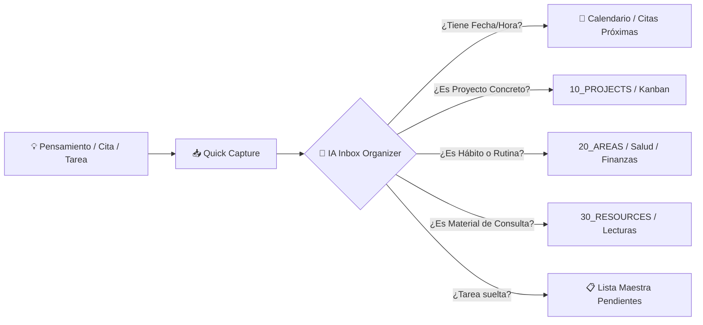

# 🧠 Brain Started — Second Brain Kit con IA (Método PARA)

Este proyecto es una plantilla de **Segundo Cerebro** lista para usar, diseñada especialmente para Obsidian y potenciada por Inteligencia Artificial (Claude Code, Cursor, Antigravity, Copilot, ChatGPT, etc.).

Te permite gestionar tu vida personal y profesional con un esfuerzo de fricción cero: **tú descargas tus pensamientos en una nota de captura rápida y la IA se encarga de estructurar, agendar, vincular y archivar todo.**

---

## 🏗️ La Metodología P.A.R.A.

La bóveda está organizada en cuatro niveles de dinamismo según el método de Tiago Forte:

| Nivel | Carpeta | Definición | Ejemplo |
| :--- | :--- | :--- | :--- |
| **01** | `01_INBOX/` | **Bandeja de entrada sin fricción**: Todo lo que llega a tu mente entra aquí primero. | Una idea suelta, una cita médica, una tarea rápida. |
| **10** | `10_PROJECTS/` | **Proyectos activos**: Tienen un objetivo concreto y una fecha límite clara. | *Lanzamiento Sitio Web*, *Renovación de Cocina*, *Certificación AWS*. |
| **20** | `20_AREAS/` | **Áreas de responsabilidad**: Estándares que mantienes a lo largo del tiempo sin fecha de caducidad. | *Salud Personal*, *Finanzas*, *Cuidado de Mascotas*, *Familia*, *Carrera*. |
| **30** | `30_RESOURCES/` | **Recursos y Referencias**: Temas de interés continuo, cheatsheets, bibliotecas de conocimiento. | *Recetas de Cocina*, *Glosario Técnico*, *Resúmenes de Libros*, *Snippets*. |
| **40** | `40_ARCHIVE/` | **Archivo histórico**: Cosas inactivas de las tres categorías anteriores para no saturar tu vista diaria. | Proyectos finalizados, áreas congeladas, cursos concluidos. |

---

## 🤖 El Sistema de IA Integrado (`00_SYSTEM/`)

El corazón de este sistema vive en `00_SYSTEM/`:

- **`00_SYSTEM/Context/OS_Context.md`**: El documento que define tu identidad, metas, valores, proyectos activos y desafíos. La IA lo lee para entender exactamente quién eres y darte respuestas 100% personalizadas.
- **`00_SYSTEM/Agents/`**:
  - `ONBOARDING_AGENT.md`: Agente interactivo que te entrevista para rellenar tu perfil, tus áreas y tus skills.
  - `AGENTS.md` & `CLAUDE.md`: Configuración de comportamiento, tono y reglas de seguridad para los asistentes.
  - `SYSTEM_BUILDER.md`: Lógica generadora de agentes y plantillas.
- **`00_SYSTEM/Skills/`**:
  - `Inbox_Capture_Skill.md`: Permite que la IA procese tu `📥_Quick_Capture.md` y mueva automáticamente las tareas al tablero maestro, las citas al calendario y las ideas a proyectos o áreas.
  - `Project_Generator_Skill.md`: Te permite decir *"Crea un nuevo proyecto para X"* y la IA genera la carpeta, el Kanban, el contexto y los accesos en segundos.
  - `00_Meta_Skill_Generator.md`: Skill para enseñarle nuevas habilidades a tu IA a medida que las necesites.
- **`00_SYSTEM/Dashboards/`**:
  - `📋_Lista_Maestra_Pendientes.md`: Lista central de pendientes organizada por urgencia y fechas.
  - `🏢_Workplace.md`: Centro de control diario con vistas dinámicas mediante Dataview.
- **`00_SYSTEM/Templates/`**: Plantillas para notas diarias, proyectos, áreas, reuniones y eventos.

---

## ⚡ Flujo de Trabajo Diario (Zero Friction)

1. **Captura sin pensar**: Anotas en `01_INBOX/📥_Quick_Capture.md` o le dices a tu IA: *"Anota esto: Dentista el jueves a las 16:00"*.
2. **Procesa cuando quieras**: Le dices a tu IA: *"Organiza mi inbox"*.
3. **Todo en su lugar**: La IA distribuye las notas, crea los archivos de evento para tu calendario y deja tu bandeja limpia.

---

## 🛡️ Seguridad y Privacidad (`.aiignore`)

Tu información confidencial siempre debe estar protegida. El archivo `.aiignore` ubicado en la raíz de la bóveda le prohíbe explícitamente a cualquier IA indexar o leer carpetas privadas (como contratos, claves, o carpetas confidenciales de tu trabajo).

---

## 🏁 ¿Listo para empezar?

Abre el archivo [[START_HERE]] y sigue los 3 sencillos pasos para iniciar tu sesión de onboarding con la IA.
